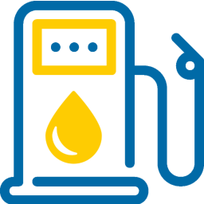

# 🇸🇪 Fuel Prices Sweden

[![GitHub Release][releases-shield]][releases]
[![License][license-shield]](LICENSE)
![Project Maintenance][maintenance-shield]

  

The integration provides fuel prices in Sweden by using a web scraper to extract prices from the [Bensinpriser](https://bensinpriser.nu/) website.

## 🚀 Installation
### Using the Marketplace (recommended)
Requires Home Assistant 2026.11 or newer.

1. Go to **Settings** > **Marketplace** and search for `Fuel Prices Sweden`, or click 
2. Select **Install**. The setup wizard opens right away, no restart needed.
3. Follow the [configuration](#Configuration) section to set up the integration

**Installed it with HACS before?** You don't need to do anything. When you update to Home Assistant 2026.11, the integration moves to the Marketplace automatically and keeps getting updates.

### Using HACS (Home Assistant 2026.10 or older)
1. In HACS, search for `Fuel Prices Sweden` and download it
2. Restart Home Assistant
3. Follow the [configuration](#Configuration) section to set up the integration

### Manual
1. Download `fuel_prices_sweden.zip` from the [latest release](https://github.com/deler-aziz/fuel_prices_sweden/releases/latest)
2. Create the folder **custom_components/fuel_prices_sweden** inside your Home Assistant **config** directory and unzip the file into it
3. Restart Home Assistant
4. Follow the [configuration](#Configuration) section to set up the integration

## ⚙️ Configuration
### UI (recommended)
1. Go to `Settings->Devices&Services->Integrations` and click on `Add integration`
2. Search for `Fuel Prices Sweden` and follow the configuration wizard

### Using configuration.yaml (Currently not supported)

## ⛽︎ Data source

The integration retrieves data from [Bensinpriser](https://bensinpriser.nu/).

**NOTE: Prices may not always be accurate**.

***
[releases]: https://github.com/deler-aziz/fuel_prices_sweden/releases
[releases-shield]: https://img.shields.io/github/v/release/deler-aziz/fuel_prices_sweden?style=for-the-badge
[license-shield]: https://img.shields.io/github/license/deler-aziz/fuel_prices_sweden?style=for-the-badge
[maintenance-shield]: https://img.shields.io/badge/maintainer-deler%20aziz-blue?style=for-the-badge

